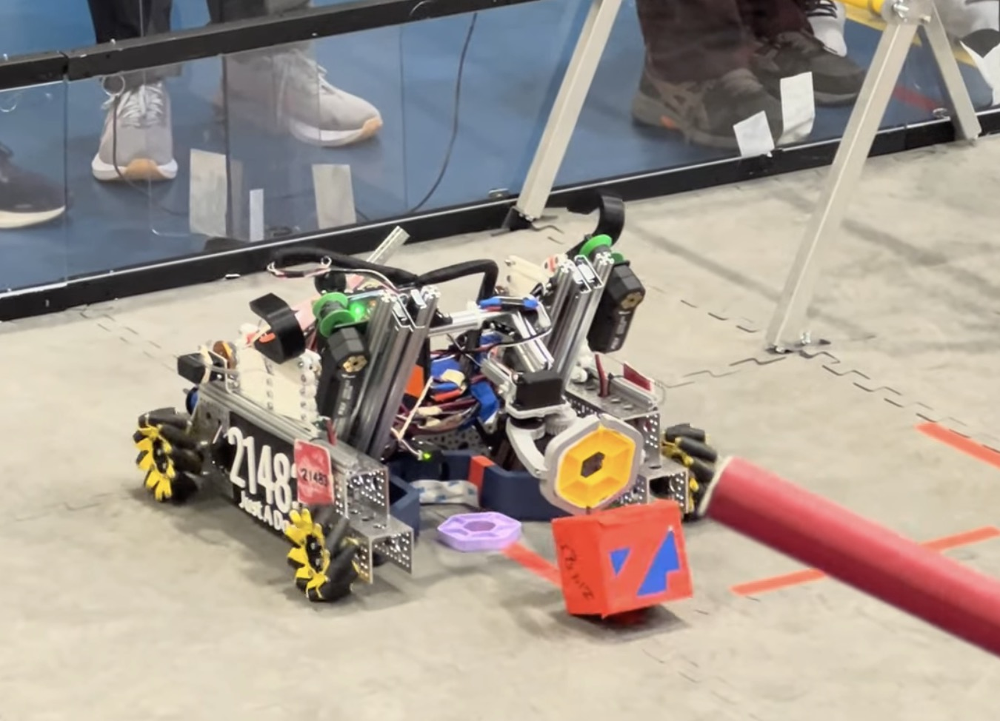

# FTC Robot Code

[Watch the robot on the competition field.](https://www.youtube.com/watch?v=RWtk5XN_LDU)

## Overview
This repository contains the on-robot software our FIRST Tech Challenge team used for the 2023-2024 CENTERSTAGE season. The codebase is designed for the REV Control Hub / Driver Hub stack and is organized around the official FTC SDK. It includes tele-operated driving controls, tuned autonomous routines for each starting position, and utility classes for managing mechanisms such as the lift, hanging system, pixel claw, and drone launcher.

## Highlights
- Field-oriented driving with IMU-based heading feedback and dynamic scaling for precision maneuvering (`DriveRobot.java`).
- Coordinated control of drivetrain, lift, claw, wrist, dual hangers, and servo-driven drone launcher, including safeguards to prevent conflicting motions.
- Distance sensor assisted positioning and prop detection used to branch autonomous logic (`DriveRobot.java`, `competition/Auto.java`).
- Parameterized autonomous base class with mirroring support for blue/red and front/back starting tiles (`competition/Auto.java` and its subclasses).
- Operator-friendly telemetry overlays that surface mechanism states, heading, and diagnostic data directly on the Driver Station.

## Autonomous Routines
The `competition` package contains the autonomous entry points used at events:
- `competition/BlueBackAuto.java`
- `competition/BlueFrontAuto.java`
- `competition/RedBackAuto.java`
- `competition/RedFrontAuto.java`

Each class inherits from `Auto` to reuse common sequencing, then sets start-tile parameters (mirroring, field side, parking strategy). The routines:
- Sample the team prop location with distance sensors and adaptive strafing.
- Deliver the preload pixel before the buzzer using tuned drive/turn distances.
- Park on the correct backdrop zone based on randomization and alliance selection.

## Tele-Op Controls
`DriveRobot.java` implements the driver-controlled op mode. For the complete gamepad mapping referenced during competition, see [`competition/RobotControls.txt`](competition/RobotControls.txt). Highlights include:
- Tank+strafe drive on `gamepad1` with speed boosts on bumpers.
- Lift extend/retract on triggers, automated hang servo presets, and wrist/claw toggles mapped to face buttons.
- Drone launch + reload on D-pad up with automatic servo cycling.

## Repository Layout
- `DriveRobot*.java`, `DriveRobot_FtcSim.java`: Tele-op experiments and simulator-friendly variants while tuning the drivetrain.
- `competition/`: Season-ready autonomous and tele-op op modes plus the control reference sheet and class diagram.
- `JustADoorLesson*.java`: Iterative lessons the team built while ramping up programming skills and testing sensor integrations.
- `RobotWithApril.java`: Early AprilTag localization prototype for exploring vision-assisted navigation.

## Getting Started
1. Clone or copy the repository into the `TeamCode/src/main/java/org/firstinspires/ftc/teamcode/` module of a standard FTC SDK Android Studio project.
2. Sync Gradle to pull the SDK dependencies if you have not already set up the SDK project.
3. Deploy to the Control Hub via USB or Wi-Fi; the TeleOp and Autonomous op modes will appear in the Driver Station under the "Concept" and "Competition" groups.
4. Use the included `RobotControls.txt` on the field to brief new drivers and spotters.

## Development Notes
- The code targets the 8.1+ FTC SDK. Verify hardware names in the `initRobot()` method match the configuration file on the Control Hub before running.
- Telemetry is formatted for HTML output; if you switch display formats, adjust the markup in `DriveRobot.java` accordingly.
- Auto routines use blocking `sleep()` calls for deterministic timing. If you migrate to Road Runner or async motion planning, refactor those waits to non-blocking scheduling.

## Media & Attribution
- Competition photo: `RobotInAction.jpg` (captured during the league tournament).
- Video recap: [YouTube – FTC Centerstage Robot Demo](https://www.youtube.com/watch?v=RWtk5XN_LDU).
- Programming & drive team: FTC Team.
